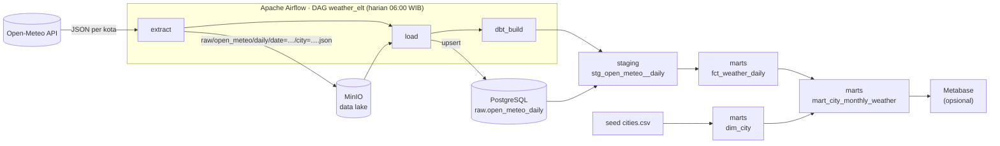
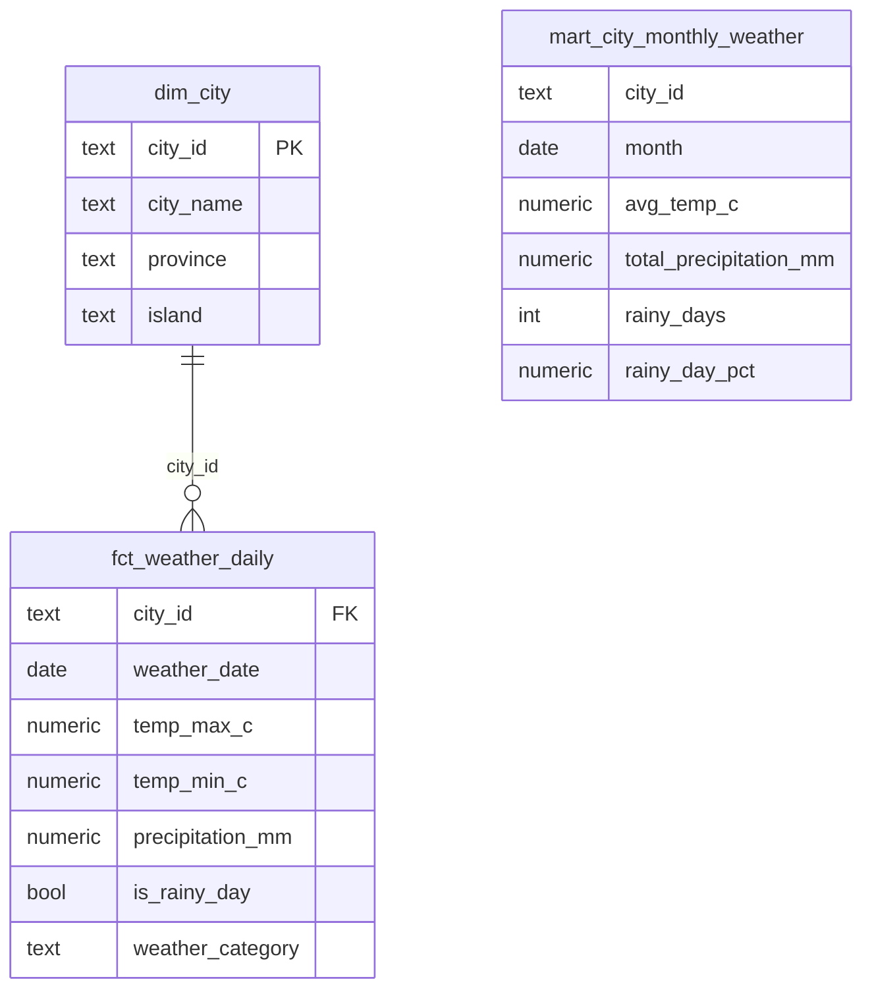
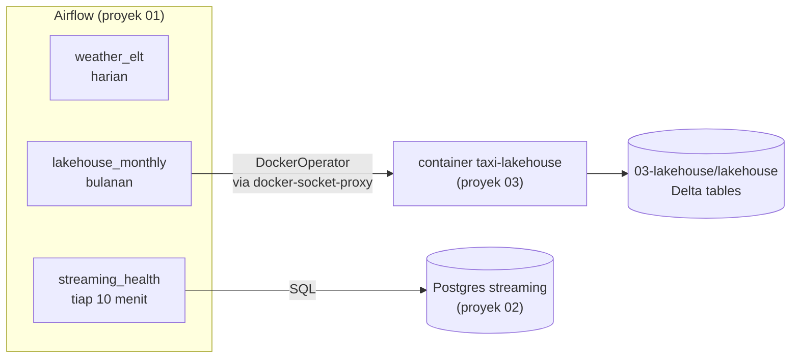

# 🌦️ Batch ELT Pipeline: Cuaca Harian Kota-Kota di Indonesia

Pipeline data harian yang mengambil data cuaca dari [Open-Meteo](https://open-meteo.com/), menyimpannya di **data lake** (MinIO), memuatnya ke **data warehouse** (PostgreSQL), lalu mentransformasinya dengan **dbt** menjadi tabel yang siap dianalisis. Semua langkah diorkestrasi oleh **Apache Airflow** dan dijalankan dengan satu perintah lewat **Docker Compose**.

> **Pertanyaan bisnis:** Kota mana di Indonesia yang paling panas, dan bagaimana pola hari hujan tiap bulan di setiap pulau?

## Arsitektur



| Lapisan | Tools | Tujuan |
|---|---|---|
| Ingestion | Python, `requests` | Ambil data harian 10 kota dari Open-Meteo |
| Data lake | MinIO (S3-compatible) | Simpan payload mentah agar bisa di-*replay* tanpa memanggil API lagi |
| Warehouse | PostgreSQL 16 | Schema `raw` → `staging` → `marts` |
| Transformasi | dbt 1.11 | Modeling, tes kualitas data, dan dokumentasi |
| Orkestrasi | Airflow 2.11 | Penjadwalan, retry, dan backfill |
| CI | GitHub Actions | Lint, unit test, dan `dbt build` terhadap Postgres sungguhan |

## Model Data



- **`fct_weather_daily`**: grain-nya satu kota per hari. Model ini *incremental*: setiap run hanya memproses baris yang baru dimuat (berdasarkan `ingested_at`).
- **`mart_city_monthly_weather`**: agregat bulanan yang siap dipakai di dashboard.
- **Kode cuaca WMO** dipetakan ke kategori yang mudah dibaca (cerah, berawan, hujan, badai petir, …) lewat macro `wmo_weather_category`.

## Cara Menjalankan

Prasyarat: Docker dan Docker Compose.

```bash
make up          # build image & jalankan Postgres, MinIO, Airflow
make trigger     # jalankan DAG sekarang
```

| Layanan | URL | Login |
|---|---|---|
| Airflow | http://localhost:8080 | `admin` / `admin` |
| MinIO console | http://localhost:9001 | `minioadmin` / `minioadmin` |
| Postgres | `localhost:5432`, db `warehouse` | `postgres` / `postgres` |
| Metabase (opsional) | http://localhost:3000 | jalankan `docker compose --profile bi up -d` |

Backfill untuk rentang tanggal tertentu (bisa sampai ~3 bulan ke belakang):

```bash
docker compose exec airflow-scheduler airflow dags backfill weather_elt -s 2026-09-01 -e 2026-09-30
```

Contoh query setelah pipeline berjalan (`make psql`):

```sql
select city_name, month, avg_temp_c, total_precipitation_mm, rainy_days
from marts.mart_city_monthly_weather
order by month desc, avg_temp_c desc;
```

### Development tanpa Docker

```bash
make setup       # pip install -e ".[dev]"
make lint test   # ruff + pytest
make dbt-local   # muat data contoh lalu dbt build (butuh Postgres di localhost:5432)
```

## Orkestrasi Lintas Proyek

Selain pipeline cuaca, Airflow di proyek ini juga berperan sebagai **control plane** untuk dua proyek lain di repo ini:



### `lakehouse_monthly`: menjadwalkan lakehouse (proyek 03)

`resolve_month → wait_for_source → fetch → bronze → silver → gold → maintain`

- **Spark tidak dipasang di image Airflow.** Setiap tahap berjalan di container image `taxi-lakehouse` lewat `DockerOperator`, jadi image Airflow tetap ramping dan dependensi Java/Spark terisolasi.
- **Akses Docker dibatasi** lewat [`docker-socket-proxy`](https://github.com/Tecnativa/docker-socket-proxy): Airflow hanya boleh mengelola container dan image, tidak bisa mengakses network, volume, atau exec.
- **Menunggu data terbit.** NYC TLC menerbitkan data dengan jeda sekitar 2 bulan dan tanggalnya tidak pasti. Sensor `wait_for_source` (mode *reschedule*, tidak menahan worker) mengecek file setiap 6 jam, sampai maksimal 14 hari.
- **Setiap tahap bisa di-retry sendiri.** Kalau silver gagal, bronze tidak perlu diulang. Semua tahap di proyek 03 idempoten, jadi retry aman.
- **Parameter saat trigger:** `month` (YYYY-MM) dan `source` (`download` = data asli, `sample` = data contoh).

```bash
make trigger-lakehouse                                   # data contoh, bulan 2024-01
make trigger-lakehouse MONTH=2024-03 SOURCE=download     # data asli NYC TLC
```

Hasilnya tersimpan di `03-lakehouse/lakehouse/`, jadi bisa langsung di-query dari proyek 03 (`make query`).

### `streaming_health`: memantau pipeline streaming (proyek 02)

Setiap 10 menit, DAG ini memeriksa **output** Spark job di Postgres proyek 02, bukan prosesnya:

| Pemeriksaan | Gagal bila |
|---|---|
| `freshness` | jendela terbaru berakhir lebih dari 5 menit lalu (job mati, macet, atau producer berhenti) |
| `volume` | pesanan/menit dalam 5 menit terakhir < 50% rata-rata 60 menit sebelumnya |

Task akan merah di Airflow bila ada pemeriksaan yang gagal. Ambang batasnya bisa diatur lewat `STREAMING_MAX_LAG_MINUTES` dan `STREAMING_MIN_VOLUME_RATIO`. Aktifkan dengan `make health` setelah stack proyek 02 berjalan.

### Notifikasi Telegram / Slack

Setiap task yang gagal (setelah semua retry habis) mengirim pesan berisi DAG, task, error, dan link log:

```
🔴 Airflow: task gagal
DAG: streaming_health
Task: check_streaming_output (percobaan 1)
Run: scheduled__2026-10-06T12:20:00+00:00
Error: freshness: jendela terbaru berakhir 14.2 menit lalu (maks 5.0)
Log: http://localhost:8080/dags/streaming_health/grid?...
```

- **Tanpa spam:** `streaming_health` berjalan setiap 10 menit, jadi DAG ini hanya mengirim alert saat **status berubah**, yaitu satu pesan 🔴 saat mulai bermasalah dan satu pesan 🟢 saat pulih. Run gagal berikutnya tidak memicu pesan ulang.
- **Aktifkan** dengan mengisi `TELEGRAM_BOT_TOKEN` + `TELEGRAM_CHAT_ID` dan/atau `SLACK_WEBHOOK_URL` di `.env` (panduannya ada di `.env.example`). Tanpa konfigurasi, pesan hanya ditulis ke log.
- Bila pengiriman alert gagal, hal itu tidak menutupi error asli task. Satu kanal yang gagal juga tidak menghalangi kanal lain.
- DAG integrity test memastikan **setiap task** di semua DAG punya callback kegagalan.

Cara termudah menjalankan semuanya adalah `make up` dari **root repo**. Perintah itu mem-build image lakehouse, menyalakan stack streaming, lalu Airflow.

## Keputusan Desain

- **ELT, bukan ETL.** Python hanya meratakan JSON (array paralel → baris). Semua logika bisnis ada di dbt, sehingga mudah dites dan terdokumentasi.
- **Idempoten di setiap langkah.** Object key di lake ditentukan oleh tanggal dan kota, tabel raw memakai `ON CONFLICT DO UPDATE`, dan fakta memakai `delete+insert` berdasarkan `(city_id, weather_date)`. Retry dan backfill tidak pernah menghasilkan duplikat. CI menjalankan `dbt build` dua kali untuk membuktikannya.
- **Raw data disimpan di lake.** Kalau logika parsing berubah, data bisa dimuat ulang dari MinIO tanpa memanggil API lagi.
- **Load dalam satu transaksi.** Kalau satu file gagal, tidak ada data setengah jadi di warehouse.
- **Satu sumber kebenaran untuk daftar kota.** `dbt/seeds/cities.csv` dipakai oleh ingestion sekaligus menjadi `dim_city`.
- **Kualitas data.** Ada 17 tes dbt: unik, not null, relasi, rentang nilai, accepted values, dan `temp_min <= temp_max`. Selain itu ada pengecekan *source freshness* (`dbt source freshness`).
- **dbt di virtualenv terpisah** di dalam image Airflow untuk menghindari konflik dependensi.

## Struktur Proyek

```
01-batch-elt-pipeline/
├── dags/
│   ├── weather_elt.py           # DAG pipeline cuaca
│   ├── lakehouse_monthly.py     # DAG lakehouse proyek 03 (DockerOperator)
│   └── streaming_health.py      # DAG pemantauan streaming proyek 02
├── src/weather_pipeline/        # kode extract, lake, transform, load
├── src/platform_ops/            # logika lintas proyek & notifikasi (tanpa Airflow, mudah dites)
├── dbt/
│   ├── seeds/cities.csv         # daftar kota (dipakai juga oleh ingestion)
│   ├── models/staging/          # pembersihan & penamaan kolom
│   ├── models/marts/            # dim, fakta, dan mart
│   ├── macros/                  # macro kategori cuaca WMO, nama schema
│   └── tests/                   # tes generik custom & tes singular
├── tests/                       # unit test, DAG integrity test, fixture JSON
├── scripts/load_fixtures.py     # muat data contoh (dipakai CI)
├── docker-compose.yml
└── Dockerfile.airflow
```

## Pengembangan Selanjutnya

- [ ] Simpan raw data dalam format Parquet dan query langsung dengan DuckDB
- [x] Notifikasi ke Slack/Telegram saat task gagal atau data terlambat
- [ ] Deploy ke cloud (GCS + BigQuery + Cloud Composer) dengan Terraform
- [ ] Dashboard publik di Metabase / Looker Studio
- [ ] Tambah sumber data lain (misalnya harga pangan) untuk analisis korelasi cuaca dan harga
