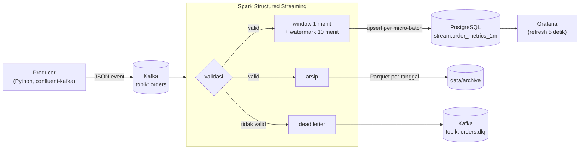

# ⚡ Streaming Pipeline: Pesanan E-commerce Real-time

Pipeline streaming yang memproses event pesanan e-commerce dari 8 kota di Indonesia **secara real-time**. Event dikirim ke **Apache Kafka**, diproses oleh **Spark Structured Streaming** dengan *event-time windowing* dan *watermark*, lalu hasilnya di-upsert ke **PostgreSQL** dan ditampilkan di dashboard **Grafana** yang diperbarui setiap 5 detik.

> **Pertanyaan bisnis:** Berapa GMV dan jumlah pesanan per menit di setiap kota *saat ini*, dan metode pembayaran apa yang paling sering dipakai?

Data sengaja dibuat "kotor" seperti di dunia nyata: ada event yang **terlambat**, **sangat terlambat**, dan **rusak**. Pipeline ini menunjukkan cara menangani ketiganya dengan benar.


<sub>Dashboard Grafana saat pipeline berjalan dengan ±40 event/detik. Diperbarui otomatis setiap 5 detik.</sub>

## Arsitektur



Satu sumber data menghasilkan **tiga query streaming** yang berjalan bersamaan:

| Query | Output | Tujuan |
|---|---|---|
| `order_metrics` | PostgreSQL `stream.order_metrics_1m` | Agregat per menit × kota × metode pembayaran untuk dashboard |
| `dead_letter` | Kafka `orders.dlq` | Event rusak beserta alasan dan posisinya di Kafka, supaya bisa diperiksa dan diproses ulang |
| `raw_archive` | Parquet terpartisi `event_date=…` | Arsip event valid untuk replay atau analisis batch (bisa jadi sumber [proyek 03](../03-lakehouse/)) |

## Konsep yang Ditunjukkan

### 1. Event time vs processing time
Agregasi memakai `event_time`, yaitu waktu pesanan terjadi, bukan waktu event diterima. Jadi event yang datang terlambat tetap masuk ke jendela menit yang benar.

### 2. Watermark dan data terlambat
```python
valid.withWatermark("event_time", "10 minutes").groupBy(window("event_time", "1 minute"), ...)
```
| Jenis event (dari producer) | Keterlambatan | Perlakuan |
|---|---|---|
| `on_time` | 0–5 detik | Dihitung |
| `late` | 1–8 menit | **Tetap dihitung**: jendela lama diperbarui, lalu di-upsert ulang ke Postgres |
| `very_late` | 15–60 menit | **Dibuang** karena melewati watermark. Jumlahnya dicatat di log (`dropped_late=…`) |

Watermark juga membatasi ukuran *state* di memori. Tanpa watermark, Spark harus menyimpan semua jendela selamanya.

> Catatan: pada batch pertama setelah start, watermark belum terbentuk, sehingga event sangat terlambat di batch itu masih dihitung. Ini perilaku normal Spark.

### 3. Dead-letter queue (DLQ)
Event yang tidak valid tidak membuat job gagal dan tidak dibuang diam-diam. Event itu dikirim ke topik `orders.dlq` dengan alasan yang jelas:

`malformed_json` · `missing_order_id` · `invalid_event_time` · `missing_city` · `unknown_payment_method` · `non_positive_amount` · `invalid_quantity`

```json
{"raw_value": "{\"order_id\": \"…\", \"amount_idr\": -125000, …}", "error_reason": "non_positive_amount",
 "topic": "orders", "partition": 1, "offset": 4211, "kafka_timestamp": "2026-10-06T16:16:02.113+07:00"}
```

### 4. Exactly-once secara efektif
- **Checkpoint** menyimpan offset Kafka dan state agregasi. Setelah restart, job melanjutkan dari posisi terakhir.
- **Upsert** dengan `ON CONFLICT (window_start, city, payment_method)`: mode output `update` mengirim nilai agregat terbaru (bukan selisih), jadi mengulang micro-batch tidak membuat angka berlipat ganda.
- **Producer idempoten** (`enable.idempotence=true`): retry dari producer tidak menghasilkan pesan duplikat di Kafka.

### 5. Observability
`StreamingQueryListener` mencatat throughput dan jumlah event yang dibuang per batch:
```
order_metrics batch=3 input_rows=245 rows_per_sec=205.9 dropped_late=13
```
Spark UI tersedia di http://localhost:4040.

## Cara Menjalankan

Prasyarat: Docker dan Docker Compose.

```bash
make up      # build image, lalu jalankan Kafka, Spark job, producer, Postgres, Grafana
make logs    # lihat progres streaming
```

| Layanan | URL | Login |
|---|---|---|
| Grafana dashboard | http://localhost:3000 | bisa dilihat tanpa login, admin: `admin` / `admin` |
| Spark UI | http://localhost:4040 | – |
| Postgres | `localhost:5433`, db `streaming` | `postgres` / `postgres` |
| Kafka (dari host) | `localhost:9092` | – |

Perintah lain:
```bash
make dlq     # lihat 10 pesan pertama di dead-letter queue
make psql    # query hasil agregasi
make clean   # hapus semua data, checkpoint, dan arsip
```

Ingin melihat perilaku watermark lebih jelas? Naikkan rasio event terlambat di `.env`:
```bash
cp .env.example .env    # lalu ubah VERY_LATE_RATIO=0.2
docker compose up -d producer
```

Contoh query:
```sql
-- 5 kota dengan GMV terbesar dalam 15 menit terakhir
select city, sum(orders) as orders, sum(gmv_idr) as gmv_idr
from stream.order_metrics_1m
where window_start >= now() - interval '15 minutes'
group by city order by gmv_idr desc limit 5;
```

## Pengujian

```bash
make setup   # butuh Java 17+
make lint test
```

- **Unit test** (16 test) memakai Spark lokal dengan DataFrame biasa. Logika transformasi dipisahkan dari I/O (`transforms.py`), sehingga bisa dites tanpa Kafka.
- Yang dites: setiap aturan validasi, pemisahan valid/invalid, format pesan DLQ, parsing zona waktu WIB, hasil agregasi per jendela, serta rasio dan determinisme generator.
- **Uji integrasi manual** dengan Kafka dan Postgres sungguhan. Semua 113 event rusak masuk ke DLQ, event yang sangat terlambat dibuang (`dropped_late`), dan setelah job di-restart dari checkpoint tidak ada data yang terhitung dua kali.
- **Uji stack Docker Compose**: layanan `kafka`, `kafka-init`, `postgres`, dan `grafana` dari `docker-compose.yml` dijalankan, lalu producer dan Spark job dihubungkan lewat listener eksternal `localhost:9092`. Hasilnya 117 micro-batch tanpa error, datasource dan dashboard Grafana termuat otomatis, dan `make dlq` menampilkan isi DLQ. Screenshot di atas diambil dari uji ini.

## Struktur Proyek

```
02-streaming-pipeline/
├── src/orders_stream/
│   ├── schema.py          # kontrak event + nilai referensi (kota, metode pembayaran)
│   ├── generator.py       # pembuat event sintetis (termasuk event terlambat & rusak)
│   ├── producer.py        # kirim event ke Kafka
│   ├── transforms.py      # parsing, validasi, agregasi (tanpa I/O, mudah dites)
│   ├── sink.py            # upsert ke Postgres
│   └── job.py             # rangkaian 3 query streaming + listener
├── tests/                 # pytest + Spark lokal
├── grafana/               # datasource & dashboard otomatis (provisioning)
├── docker-compose.yml
├── Dockerfile             # Python + Java 17 + PySpark + connector Kafka
└── Makefile
```

## Keputusan Desain

- **Kafka (KRaft) tanpa Zookeeper**: setup modern dengan satu node, cukup untuk lokal.
- **Key pesan = `order_id`**: event dari pesanan yang sama selalu masuk partisi yang sama, sehingga urutannya terjaga.
- **`foreachBatch` + psycopg2, bukan JDBC sink**: JDBC sink bawaan Spark hanya bisa append. Upsert butuh SQL sendiri.
- **Waktu dikirim sebagai string ber-offset (`+07:00`)**: menghindari jebakan konversi zona waktu antara Spark, Python, dan Postgres.
- **`maxOffsetsPerTrigger`**: membatasi ukuran batch saat mengejar ketertinggalan (misalnya setelah job mati lama), supaya job tidak kehabisan memori.

## Pengembangan Selanjutnya

- [ ] Schema Registry + Avro/Protobuf untuk kontrak event yang lebih ketat
- [ ] Alert (Grafana alerting) bila GMV turun drastis atau DLQ melonjak
- [ ] Deteksi anomali sederhana, misalnya lonjakan pesanan COD di satu kota
- [ ] Simpan agregat ke ClickHouse untuk query analitik yang lebih cepat
- [ ] Menjalankan Spark di cluster (Kubernetes / Spark Standalone)
