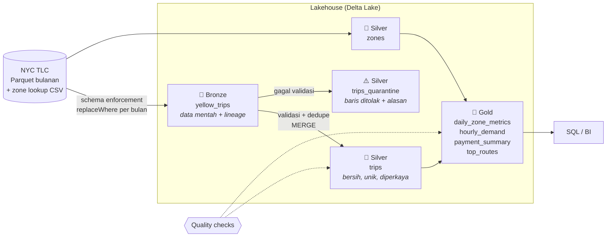

# 🏞️ Lakehouse: NYC Taxi dengan Arsitektur Medallion

Lakehouse yang mengolah data perjalanan **NYC Yellow Taxi** (data publik resmi dari [NYC TLC](https://www.nyc.gov/site/tlc/about/tlc-trip-record-data.page), ~3 juta perjalanan per bulan) menggunakan **PySpark** dan **Delta Lake**, dengan arsitektur **medallion**: bronze → silver → gold.

> **Pertanyaan bisnis:** Kapan dan di mana permintaan taksi paling tinggi, rute mana yang paling ramai, dan bagaimana pola pembayaran serta tip penumpang?

## Arsitektur



| Lapisan | Tabel | Isi | Cara tulis |
|---|---|---|---|
| **Bronze** | `yellow_trips` | Data mentah dengan skema seragam, ditambah `_source_file`, `_source_month`, dan `_ingested_at` | `overwrite` + `replaceWhere` per bulan (partisi `_source_month`) |
| **Silver** | `trips` | Perjalanan valid dan unik, ditambah kolom turunan (durasi, kecepatan, % tip, jam, hari) | `MERGE` berdasarkan `trip_id` (partisi `pickup_month`) |
| **Silver** | `trips_quarantine` | Baris yang ditolak beserta `rejection_reason` | `overwrite` + `replaceWhere` per bulan |
| **Silver** | `zones` | 265 zona taksi (borough, nama zona) | `overwrite` |
| **Gold** | `daily_zone_metrics` | Per tanggal × zona penjemputan: jumlah perjalanan, pendapatan, rata-rata tarif, jarak, durasi, % tip | full refresh |
| **Gold** | `hourly_demand` | Rata-rata perjalanan per hari untuk setiap hari-dalam-minggu × jam, median kecepatan | full refresh |
| **Gold** | `payment_summary` | Per bulan × metode bayar: jumlah, pendapatan, pangsa (%) | full refresh |
| **Gold** | `top_routes` | 20 rute (zona asal → tujuan) teramai per bulan | full refresh |

## Konsep yang Ditunjukkan

### 1. Schema enforcement di bronze
File TLC antarbulan **tidak konsisten**: `passenger_count` kadang `double` kadang `bigint`, `Airport_fee` vs `airport_fee`, dan file 2025 menambah kolom baru. Bronze menyeragamkan nama kolom dan tipe ke skema tetap (`bronze.BRONZE_COLUMNS`), sehingga bulan-bulan berbeda bisa disimpan di satu tabel.

### 2. Validasi dan karantina (bukan dibuang diam-diam)
Setiap baris diperiksa dengan aturan berikut. Baris yang gagal masuk ke `trips_quarantine` beserta alasannya:

| Alasan | Aturan |
|---|---|
| `missing_timestamp` | waktu jemput/antar kosong |
| `pickup_outside_file_month` | tanggal tidak sesuai bulan file (data asli memuat tanggal nyasar, mis. tahun 2002) |
| `non_positive_duration` / `duration_too_long` | durasi ≤ 0 atau > 6 jam |
| `non_positive_distance` / `distance_too_long` | jarak ≤ 0 atau > 200 mil |
| `negative_amount` | tarif atau total negatif |
| `too_many_passengers` | penumpang > 8 |
| `unknown_location` | ID zona di luar 1–265 |

### 3. Deduplikasi dan idempotensi
- `trip_id` = SHA-256 dari *natural key* (vendor, waktu jemput/antar, zona, jarak, total). Duplikat persis dalam file dibuang dengan `dropDuplicates`.
- Silver ditulis dengan **`MERGE`**, bronze dan karantina dengan **`replaceWhere`**. Menjalankan ulang bulan yang sama tidak menambah baris, dan bulan lain tidak tersentuh. Ini sudah diuji di `test_build_month_splits_dedupes_and_is_idempotent`.

### 4. Quality gates
Pipeline **berhenti** (raise `DataQualityError`) bila ada pemeriksaan yang gagal, supaya data rusak tidak sampai ke gold:
```
[PASS] rejection_rate_2024-01: 3.15% rejected (max 10%)
[PASS] silver_trip_id_unique: 0 duplicates
[PASS] silver_required_not_null: 0 rows with nulls
[PASS] silver_values_in_range: 0 rows out of range
[PASS] gold_reconciles_with_silver: silver=96913 gold=96913
```

### 5. Fitur Delta Lake
- **ACID transaction**: pembaca tidak pernah melihat data setengah jadi.
- **Time travel**: lihat atau pulihkan versi lama.
  ```bash
  make query SQL="select count(*) from delta.\`/lakehouse/silver/trips\` version as of 0"
  ```
- **Riwayat operasi**: `make history TABLE=silver/trips` menampilkan WRITE, MERGE, OPTIMIZE, dan VACUUM beserta metriknya.
- **OPTIMIZE + Z-ORDER** (`make maintain`): menggabungkan file kecil dan menyusun data berdasarkan `pickup_date, pu_location_id`, sehingga query yang memfilter tanggal/zona membaca lebih sedikit file.

### 6. Optimasi Spark
- **Broadcast join** untuk tabel zona (265 baris), supaya tabel perjalanan berukuran jutaan baris tidak perlu di-shuffle.
- **Partisi** berdasarkan bulan, sehingga query satu bulan hanya membaca partisi itu (*partition pruning*).
- **Cache** DataFrame hasil validasi, karena dipakai berkali-kali (valid, karantina, statistik).

## Cara Menjalankan

Prasyarat: Docker dan Docker Compose.

**Opsi A: data contoh** (cepat, tanpa unduhan besar; skema identik dengan TLC dan sengaja diberi baris kotor):
```bash
make build
make sample      # 2 bulan × 50 ribu perjalanan
make run
```

**Opsi B: data asli NYC TLC:**
```bash
make build
make download MONTHS="2024-01 2024-02 2024-03"   # ~50 MB per bulan
make run      MONTHS="2024-01 2024-02 2024-03"
```

Eksplorasi hasil:
```bash
make query SQL="select * from gold_payment_summary order by pickup_month, trips desc"
make query SQL="select pu_zone, sum(trips) trips, sum(revenue_usd) revenue from gold_daily_zone_metrics group by 1 order by 2 desc limit 10"
make query SQL="select rejection_reason, count(*) from silver_trips_quarantine group by 1 order by 2 desc"
make maintain
make history TABLE=silver/trips
```

Tabel yang bisa di-query: `bronze_yellow_trips`, `silver_trips`, `silver_trips_quarantine`, `silver_zones`, `gold_daily_zone_metrics`, `gold_hourly_demand`, `gold_payment_summary`, `gold_top_routes`.

Penjadwalan bulanan otomatis (menunggu data terbit, lalu bronze → silver → gold → maintain) dilakukan oleh DAG `lakehouse_monthly` di [proyek 01](../01-batch-elt-pipeline/README.md#orkestrasi-lintas-proyek), yang menjalankan image ini lewat `DockerOperator`.

Tiap lapisan juga bisa dijalankan terpisah:
```bash
docker compose run --rm lakehouse run --months 2024-01 --stage silver
```

## Pengujian

```bash
make setup    # butuh Java 17+
make lint test
```

Ada **24 test** yang memakai Spark + Delta lokal:
- **Bronze**: menangani schema drift (huruf besar/kecil, tipe berbeda, kolom hilang), idempoten per bulan, kolom lineage.
- **Silver**: setiap aturan validasi, stabilitas `trip_id`, kolom turunan, dan idempotensi `MERGE`.
- **Gold**: nilai agregat dari data yang diketahui, total pangsa pembayaran = 100%, urutan rute, serta quality gate yang menghentikan pipeline.
- **Data contoh**: skema identik dengan TLC dan memuat baris kotor serta duplikat.

## Struktur Proyek

```
03-lakehouse/
├── src/taxi_lakehouse/
│   ├── bronze.py       # schema enforcement + ingest per bulan
│   ├── silver.py       # validasi, karantina, dedupe, enrich, MERGE
│   ├── gold.py         # tabel agregat
│   ├── quality.py      # quality gates
│   ├── pipeline.py     # orkestrasi lapisan + maintenance (OPTIMIZE/VACUUM)
│   ├── spark.py        # SparkSession + Delta
│   ├── sample.py       # data contoh berskema TLC
│   ├── download.py     # unduh data asli
│   └── __main__.py     # CLI: sample, download, run, maintain, query, history
├── tests/
├── Dockerfile
├── docker-compose.yml
└── Makefile
```

## Keputusan Desain

- **Delta Lake, bukan Parquet biasa**: dengan Parquet biasa, menulis ulang satu bulan berisiko meninggalkan data setengah jadi dan tidak bisa di-rollback. Delta memberi ACID transaction, MERGE, dan time travel.
- **Tabel berbasis path (tanpa Hive metastore)**: setup lebih sederhana. Untuk query SQL, CLI mendaftarkan setiap tabel sebagai temp view.
- **Gold di-refresh penuh**: tabel gold kecil (ribuan baris), jadi rebuild penuh lebih sederhana dan pasti konsisten dengan silver. Pada skala lebih besar, gold bisa diubah menjadi incremental per bulan.
- **Session timezone UTC**: data TLC berisi waktu lokal New York tanpa zona waktu. UTC mencegah Spark menggeser jam.
- **Data contoh berskema identik**: test dan CI tidak bergantung pada unduhan ~50 MB, tapi kode yang sama tetap jalan untuk data asli.

## Pengembangan Selanjutnya

- [ ] Simpan lakehouse di object storage (MinIO/S3) alih-alih disk lokal
- [x] Orkestrasi bulanan dengan Airflow: DAG `lakehouse_monthly` di [proyek 01](../01-batch-elt-pipeline/README.md#orkestrasi-lintas-proyek)
- [ ] Gold incremental dan Change Data Feed Delta
- [ ] Query gold dengan DuckDB atau Trino, lalu buat dashboard
- [ ] Bandingkan dengan Apache Iceberg
