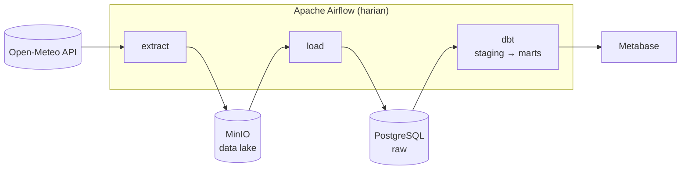

# 🛠️ Portofolio Data Engineering

[](https://github.com/dinulimann/dataen/actions/workflows/batch-elt-ci.yml)


Repositori ini berisi kumpulan proyek **data engineering end-to-end**. Setiap proyek dibuat seperti sistem produksi berskala kecil: ada ingestion dari sumber nyata, penyimpanan berlapis, transformasi yang teruji, orkestrasi, dan CI. Semuanya bisa dijalankan di laptop dengan satu perintah.

Tujuannya menunjukkan bahwa saya bisa **memindahkan data dari sumber ke tempat yang berguna secara andal**, bukan sekadar menulis notebook analisis.

---

## 📂 Daftar Proyek

| # | Proyek | Ringkasan | Stack | Status |
|---|---|---|---|---|
| 01 | [**Batch ELT Pipeline: Cuaca Indonesia**](01-batch-elt-pipeline/) | Pipeline harian yang mengambil data cuaca 10 kota dari Open-Meteo, menyimpannya di data lake, lalu memodelkannya menjadi mart bulanan per kota. | Airflow · dbt · PostgreSQL · MinIO · Docker · GitHub Actions | ✅ Selesai |
| 02 | Streaming Pipeline | Memproses event (misalnya transaksi e-commerce simulasi) secara real-time, dengan windowing dan penanganan data terlambat. | Kafka/Redpanda · Spark Structured Streaming · ClickHouse | 🗓️ Rencana |
| 03 | Lakehouse | Mengolah dataset besar (misalnya NYC Taxi) dengan arsitektur medallion bronze → silver → gold. | PySpark · Delta Lake/Iceberg · Parquet | 🗓️ Rencana |

### ⭐ Sorotan Proyek 01



- **Pertanyaan bisnis:** kota mana yang paling panas, dan bagaimana pola hari hujan tiap bulan di setiap pulau?
- **Idempoten:** retry dan backfill tidak pernah menghasilkan duplikat. CI menjalankan `dbt build` dua kali untuk membuktikannya.
- **Kualitas data:** 17 tes dbt (unik, not null, relasi, rentang nilai, accepted values) ditambah pengecekan *source freshness*.
- **Data mentah disimpan di lake**, jadi data bisa dimuat ulang tanpa memanggil API lagi.

👉 Detail arsitektur, model data, dan keputusan desain ada di [README proyek 01](01-batch-elt-pipeline/README.md).

---

## 🧠 Kompetensi yang Ditunjukkan

| Area | Yang dipraktikkan | Di mana |
|---|---|---|
| **Ingestion** | Mengambil data dari REST API, validasi kontrak payload, error handling | `01/src/weather_pipeline/extract.py`, `transform.py` |
| **Data lake** | Object storage S3-compatible, partisi gaya Hive (`date=…/city=…`) | `01/src/weather_pipeline/lake.py` |
| **Data warehouse** | Upsert idempoten (`ON CONFLICT`), load dalam satu transaksi | `01/src/weather_pipeline/load.py` |
| **Data modeling** | Lapisan staging → marts, star schema (dim + fact), model incremental | `01/dbt/models/` |
| **Kualitas data** | Tes generik custom, tes singular, source freshness | `01/dbt/tests/`, `*.yml` |
| **Orkestrasi** | DAG Airflow dengan TaskFlow API, retry, backfill | `01/dags/weather_elt.py` |
| **Infrastruktur** | Docker Compose multi-service, healthcheck, konfigurasi lewat env var | `01/docker-compose.yml` |
| **Software engineering** | Unit test (pytest), lint (ruff), struktur package Python | `01/tests/`, `pyproject.toml` |
| **CI/CD** | GitHub Actions dengan Postgres service untuk tes integrasi dbt | `.github/workflows/` |

---

## 🗂️ Struktur Repositori

```
dataen/
├── README.md                       ← halaman ini
├── .github/
│   └── workflows/
│       └── batch-elt-ci.yml        # CI proyek 01: lint, pytest, dbt build
└── 01-batch-elt-pipeline/          # Proyek 01 (lihat README di dalamnya)
    ├── dags/                       # DAG Airflow
    ├── src/weather_pipeline/       # Kode Python: extract, lake, transform, load
    ├── dbt/                        # Proyek dbt: seeds, models, macros, tests
    ├── tests/                      # Unit test + fixture JSON
    ├── scripts/                    # Utilitas (memuat data contoh)
    ├── docker/                     # Skrip inisialisasi container
    ├── docker-compose.yml
    ├── Dockerfile.airflow
    └── Makefile                    # Perintah singkat: make up, make test, dst.
```

Setiap proyek berdiri sendiri, dengan dependensi, Docker Compose, dan README masing-masing. Jadi tiap proyek bisa dipelajari atau dijalankan tanpa menyentuh proyek lain.

---

## 🚀 Mulai Cepat

**Prasyarat:** Git, Docker dan Docker Compose, serta `make`. Python 3.11+ hanya dibutuhkan untuk development lokal.

```bash
git clone https://github.com/dinulimann/dataen.git
cd dataen/01-batch-elt-pipeline

make up        # build image dan jalankan Postgres, MinIO, Airflow
make trigger   # jalankan pipeline sekarang
```

Setelah itu buka:

| Layanan | URL | Login |
|---|---|---|
| Airflow | http://localhost:8080 | `admin` / `admin` |
| MinIO console | http://localhost:9001 | `minioadmin` / `minioadmin` |
| Metabase (opsional) | http://localhost:3000 | `docker compose --profile bi up -d` |

Untuk development tanpa Docker (lint, test, dbt dengan data contoh):

```bash
make setup     # pip install -e ".[dev]"
make lint test
make dbt-local # butuh Postgres di localhost:5432
```

Ketik `make help` untuk melihat semua perintah.

---

## ✅ Standar yang Diterapkan di Setiap Proyek

Agar konsisten, setiap proyek di repositori ini mengikuti checklist berikut:

- [x] **Bisa dijalankan dengan satu perintah** (`make up`) tanpa setup manual
- [x] **Idempoten**: menjalankan ulang untuk periode yang sama tidak menimbulkan duplikat
- [x] **Data mentah disimpan** sebelum ditransformasi, supaya bisa di-*replay*
- [x] **Tes otomatis** untuk kode (pytest) dan data (tes dbt)
- [x] **CI di GitHub Actions** yang berjalan di setiap push
- [x] **README** berisi diagram arsitektur, cara menjalankan, keputusan desain, dan rencana pengembangan
- [x] **Tanpa kredensial di repo**: konfigurasi lewat `.env` (contohnya ada di `.env.example`)

---

## 🗺️ Roadmap

- [x] **Proyek 01:** Batch ELT (Airflow, dbt, PostgreSQL, MinIO)
- [ ] Proyek 01: dashboard Metabase dan screenshot di README
- [ ] Proyek 01: deploy ke cloud (GCS + BigQuery) dengan Terraform
- [ ] **Proyek 02:** Streaming pipeline (Kafka + Spark Structured Streaming)
- [ ] **Proyek 03:** Lakehouse (PySpark + Delta Lake/Iceberg)
- [ ] Blog atau tulisan singkat tentang pelajaran dari tiap proyek

---

## 👋 Tentang Saya

<!-- TODO: ganti bagian ini dengan profil kamu -->

Halo! Saya **[Nama Kamu]**, seorang calon Data Engineer yang tertarik membangun pipeline data yang andal dan mudah dirawat.

- 💼 LinkedIn: [linkedin.com/in/username](https://linkedin.com/in/username)
- 📧 Email: [email@contoh.com](mailto:email@contoh.com)
- 🌐 Blog/Website: _opsional_

Terbuka untuk kesempatan **Data Engineer / Analytics Engineer**. Silakan hubungi saya!

---

<sub>Data cuaca disediakan oleh [Open-Meteo](https://open-meteo.com/) (CC BY 4.0).</sub>
