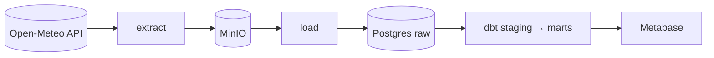
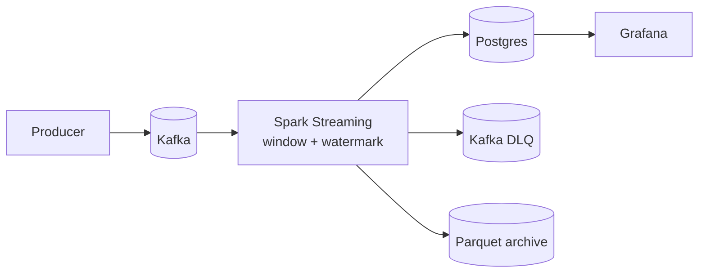
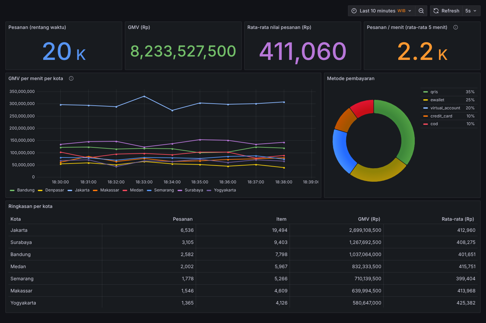
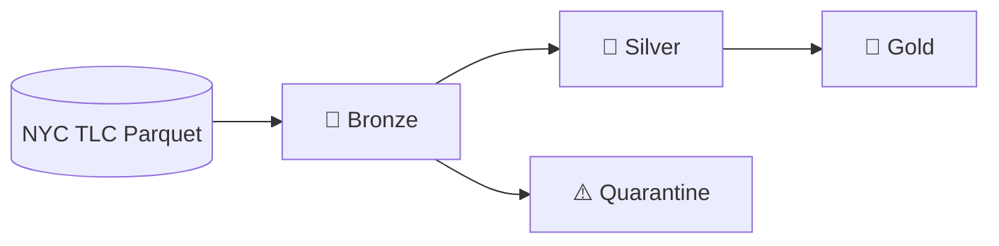
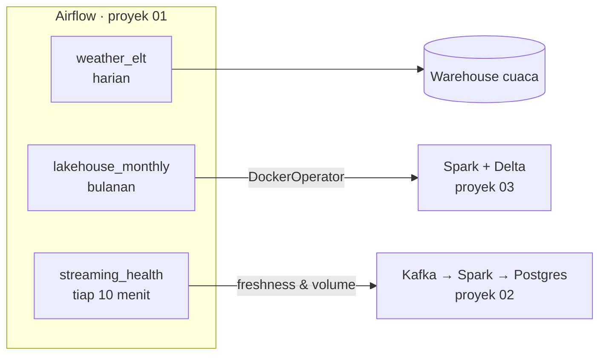

# 🛠️ Portofolio Data Engineering

[](https://github.com/dinulimann/dataen/actions/workflows/batch-elt-ci.yml)
[](https://github.com/dinulimann/dataen/actions/workflows/streaming-ci.yml)
[](https://github.com/dinulimann/dataen/actions/workflows/lakehouse-ci.yml)


Repositori ini berisi kumpulan proyek **data engineering end-to-end** yang mencakup tiga pola utama pemrosesan data: **batch**, **streaming**, dan **lakehouse**. Setiap proyek dibuat seperti sistem produksi berskala kecil: ada ingestion dari sumber nyata, penyimpanan berlapis, transformasi yang teruji, quality check, dan CI. Semuanya bisa dijalankan di laptop dengan Docker.

Tujuannya menunjukkan bahwa saya bisa **memindahkan data dari sumber ke tempat yang berguna secara andal**, bukan sekadar menulis notebook analisis.

---

## 📂 Daftar Proyek

| # | Proyek | Pola | Ringkasan | Stack |
|---|---|---|---|---|
| 01 | [**Batch ELT: Cuaca Indonesia**](01-batch-elt-pipeline/) | Batch harian | Data cuaca 10 kota dari Open-Meteo → data lake → warehouse → model dbt (dim, fact, mart bulanan) | Airflow · dbt · PostgreSQL · MinIO |
| 02 | [**Streaming: Pesanan E-commerce Real-time**](02-streaming-pipeline/) | Streaming | Event pesanan dari 8 kota → Kafka → agregasi per menit dengan watermark → dashboard real-time, dengan dead-letter queue | Kafka · Spark Structured Streaming · PostgreSQL · Grafana |
| 03 | [**Lakehouse: NYC Taxi**](03-lakehouse/) | Lakehouse / big data | Jutaan perjalanan taksi → bronze → silver (validasi, karantina, MERGE) → gold, dengan quality gates dan time travel | PySpark · Delta Lake · Parquet |

### 01 · Batch ELT Pipeline


- **Pertanyaan bisnis:** kota mana yang paling panas, dan bagaimana pola hari hujan tiap bulan di setiap pulau?
- Idempoten di setiap langkah: object key deterministik, `ON CONFLICT` upsert, dan model dbt incremental. CI menjalankan `dbt build` dua kali untuk membuktikannya.
- 17 tes kualitas data dbt dan pengecekan source freshness.

### 02 · Streaming Pipeline




- **Pertanyaan bisnis:** berapa GMV dan jumlah pesanan per menit di setiap kota *saat ini*?
- Agregasi berbasis event time dengan **watermark**: event terlambat tetap dihitung, sedangkan event yang terlalu terlambat dibuang dan jumlahnya dicatat di log.
- Event rusak masuk **dead-letter queue** beserta alasannya. **Checkpoint + upsert** membuat restart tidak menghitung data dua kali.

### 03 · Lakehouse


- **Pertanyaan bisnis:** kapan dan di mana permintaan taksi paling tinggi, dan rute mana yang paling ramai?
- Schema enforcement untuk menangani file bulanan yang skemanya berubah-ubah. Baris tidak valid dikarantina beserta alasannya.
- Fitur Delta Lake: `MERGE`, `replaceWhere`, time travel, `OPTIMIZE ... ZORDER BY`. Pipeline berhenti otomatis bila quality gate gagal.

👉 Detail arsitektur, model data, dan keputusan desain ada di README masing-masing proyek.

### 🔗 Satu Platform: Airflow sebagai Control Plane

Ketiga proyek bisa berjalan sendiri-sendiri, tapi juga bisa dijalankan sebagai **satu platform**. Airflow di proyek 01 menjadwalkan lakehouse dan memantau streaming:



- **`lakehouse_monthly`**: menunggu data NYC TLC terbit (sensor), lalu menjalankan bronze → silver → gold → maintain. Setiap tahap berjalan di container image proyek 03 lewat `DockerOperator` dan bisa di-retry sendiri.
- **`streaming_health`**: memeriksa output pipeline streaming. Task merah bila data berhenti mengalir (> 5 menit) atau volume anjlok di bawah 50% baseline.

```bash
make up          # build image lakehouse, jalankan stack streaming + Airflow
make lakehouse   # jalankan lakehouse lewat Airflow (data contoh)
make health      # aktifkan pemantauan streaming
```

---

## 🧠 Kompetensi yang Ditunjukkan

| Area | Yang dipraktikkan | Proyek |
|---|---|---|
| **Ingestion** | REST API, producer Kafka (idempoten), unduhan file besar secara atomik | 01, 02, 03 |
| **Batch processing** | Load harian/bulanan, backfill, partisi per tanggal | 01, 03 |
| **Stream processing** | Event-time windowing, watermark, stateful aggregation, checkpoint, `foreachBatch` | 02 |
| **Penyimpanan** | Data lake S3-compatible, Parquet terpartisi, Delta Lake (ACID, time travel) | 01, 02, 03 |
| **Data modeling** | Staging → marts, star schema, model incremental, arsitektur medallion | 01, 03 |
| **Kualitas data** | Tes dbt, validasi + dead-letter queue, karantina, quality gates yang menghentikan pipeline | 01, 02, 03 |
| **Idempotensi** | Upsert, `MERGE`, `replaceWhere`, object key deterministik, exactly-once secara efektif | 01, 02, 03 |
| **Optimasi** | Broadcast join, partition pruning, Z-ORDER, caching, `maxOffsetsPerTrigger` | 02, 03 |
| **Orkestrasi** | DAG Airflow (TaskFlow), retry, backfill, sensor (mode reschedule), `DockerOperator`, orkestrasi lintas sistem | 01, 02, 03 |
| **Observability** | Streaming query listener, source freshness, dashboard Grafana, health check freshness & volume | 01, 02 |
| **Infrastruktur** | Docker Compose multi-service, healthcheck, provisioning otomatis | 01, 02, 03 |
| **Software engineering** | Logika transformasi dipisah dari I/O, pytest (50+ test), ruff, packaging Python | 01, 02, 03 |
| **CI/CD** | GitHub Actions per proyek, termasuk tes integrasi dbt dengan Postgres dan DAG integrity test | 01, 02, 03 |

---

## 🗂️ Struktur Repositori

```
dataen/
├── README.md                        ← halaman ini
├── Makefile                         # jalankan ketiga proyek sebagai satu platform
├── .github/workflows/               # CI terpisah untuk tiap proyek
│   ├── batch-elt-ci.yml
│   ├── streaming-ci.yml
│   └── lakehouse-ci.yml
├── 01-batch-elt-pipeline/           # Airflow + dbt + Postgres + MinIO (+ control plane)
│   ├── dags/  src/  dbt/  tests/
│   └── docker-compose.yml, Makefile, README.md
├── 02-streaming-pipeline/           # Kafka + Spark Structured Streaming + Grafana
│   ├── src/  tests/  grafana/
│   └── docker-compose.yml, Makefile, README.md
└── 03-lakehouse/                    # PySpark + Delta Lake (medallion)
    ├── src/  tests/
    └── docker-compose.yml, Makefile, README.md
```

Setiap proyek **berdiri sendiri**, dengan dependensi, Docker Compose, Makefile, CI, dan README masing-masing. Jadi tiap proyek bisa dipelajari atau dijalankan tanpa menyentuh proyek lain. `Makefile` di root merangkai ketiganya menjadi satu platform.

---

## 🚀 Mulai Cepat

**Prasyarat:** Git, Docker dan Docker Compose, serta `make`. Untuk development lokal tanpa Docker: Python 3.11+, dan Java 17+ untuk proyek 02 dan 03.

```bash
git clone https://github.com/dinulimann/dataen.git
cd dataen
```

**Seluruh platform sekaligus:**
```bash
make up && make lakehouse && make health
```
Lalu buka Airflow di http://localhost:8080 (`admin`/`admin`) dan Grafana di http://localhost:3000.

**Atau per proyek:**

| Proyek | Perintah | Lalu buka |
|---|---|---|
| 01 · Batch ELT | `cd 01-batch-elt-pipeline && make up && make trigger` | Airflow http://localhost:8080 (`admin`/`admin`) |
| 02 · Streaming | `cd 02-streaming-pipeline && make up` | Grafana http://localhost:3000 |
| 03 · Lakehouse | `cd 03-lakehouse && make build sample run` | `make query SQL="select * from gold_top_routes"` |

Ketik `make help` di folder proyek mana pun untuk melihat semua perintah.

> Proyek 01 dan 02 sama-sama memakai Postgres, tapi di port host yang berbeda (5432 dan 5433), jadi keduanya bisa berjalan bersamaan. Grafana (02) dan Metabase opsional (01) sama-sama memakai port 3000, jadi jalankan salah satu saja.

---

## ✅ Standar yang Diterapkan di Setiap Proyek

- [x] **Bisa dijalankan dengan satu perintah** tanpa setup manual
- [x] **Idempoten**: menjalankan ulang (retry, backfill, restart) tidak menimbulkan duplikat
- [x] **Data mentah disimpan** sebelum ditransformasi, supaya bisa di-*replay*
- [x] **Data buruk tidak dibuang diam-diam**: masuk karantina atau DLQ beserta alasannya
- [x] **Tes otomatis** untuk kode (pytest) dan data (tes dbt / quality gates)
- [x] **CI di GitHub Actions** yang berjalan setiap kali proyek terkait berubah
- [x] **README** berisi diagram arsitektur, cara menjalankan, keputusan desain, dan rencana pengembangan
- [x] **Tanpa kredensial di repo**: konfigurasi lewat environment variable (contohnya ada di `.env.example`)

---

## 🗺️ Roadmap

- [x] **Proyek 01:** Batch ELT (Airflow, dbt, PostgreSQL, MinIO)
- [x] **Proyek 02:** Streaming (Kafka, Spark Structured Streaming, Grafana)
- [x] **Proyek 03:** Lakehouse (PySpark, Delta Lake, medallion)
- [x] Screenshot dashboard Grafana (proyek 02)
- [ ] Screenshot Airflow dan Metabase (proyek 01)
- [x] Hubungkan proyek: Airflow menjadwalkan lakehouse dan memantau streaming
- [ ] Notifikasi Telegram/Slack saat DAG gagal
- [ ] Deploy salah satu proyek ke cloud (GCP/AWS) dengan Terraform
- [ ] Tulisan singkat (blog) tentang pelajaran dari tiap proyek

---

## 👋 Tentang Saya

<!-- TODO: ganti bagian ini dengan profil kamu -->

Halo! Saya **[Nama Kamu]**, seorang calon Data Engineer yang tertarik membangun pipeline data yang andal dan mudah dirawat.

- 💼 LinkedIn: [linkedin.com/in/username](https://linkedin.com/in/username)
- 📧 Email: [email@contoh.com](mailto:email@contoh.com)
- 🌐 Blog/Website: _opsional_

Terbuka untuk kesempatan **Data Engineer / Analytics Engineer**. Silakan hubungi saya!

---

<sub>Sumber data: [Open-Meteo](https://open-meteo.com/) (CC BY 4.0) · [NYC Taxi & Limousine Commission](https://www.nyc.gov/site/tlc/about/tlc-trip-record-data.page) · data e-commerce bersifat sintetis.</sub>
