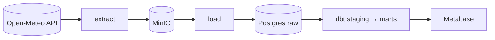
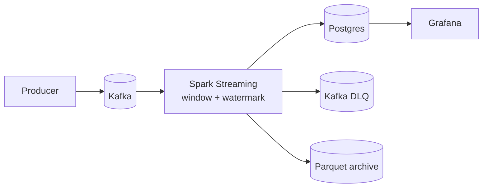
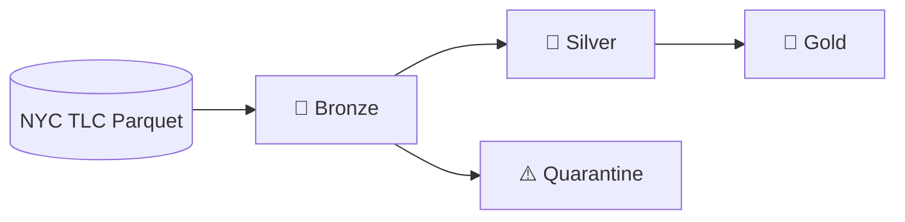
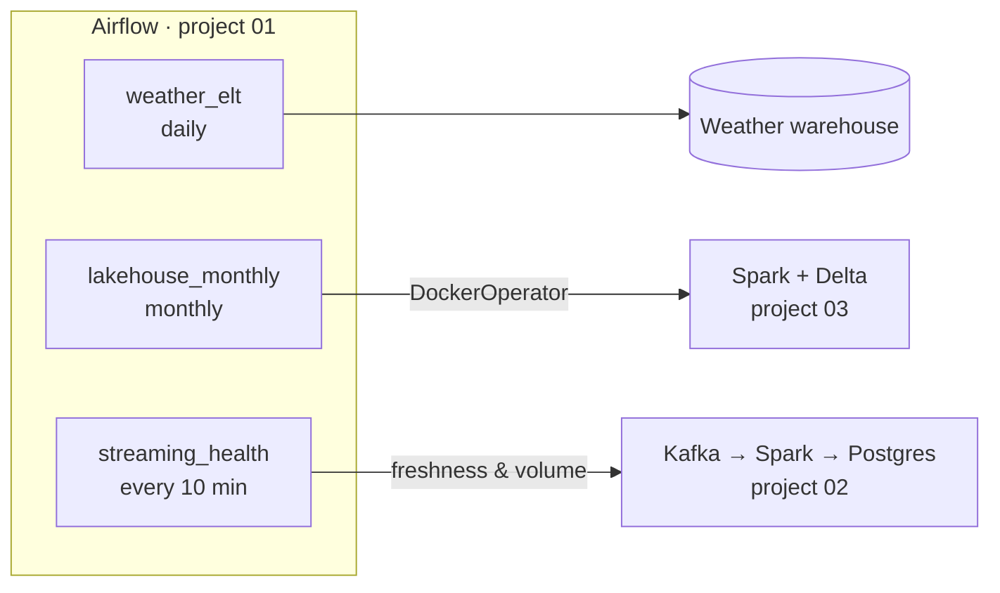

# 🛠️ Data Engineering Portfolio

[](https://github.com/dinulimann/dataen/actions/workflows/batch-elt-ci.yml)
[](https://github.com/dinulimann/dataen/actions/workflows/streaming-ci.yml)
[](https://github.com/dinulimann/dataen/actions/workflows/lakehouse-ci.yml)
[](https://dinulimann.github.io/dataen/)


Three **end-to-end data engineering** projects covering the three main processing patterns: **batch**, **streaming** and **lakehouse**. Each one is built like a small production system, with ingestion from real sources, layered storage, tested transformations, quality checks and CI. Everything runs on a laptop with Docker.

The point is to show that I can **move data from where it is to where it's useful, reliably**, not just write an analysis notebook.

> 🇮🇩 Versi Bahasa Indonesia: [README.id.md](README.id.md). The per-project READMEs (architecture, data model, design decisions) are in Indonesian.

---

## 📂 Projects

| # | Project | Pattern | Summary | Stack |
|---|---|---|---|---|
| 01 | [**Batch ELT: Indonesian Weather**](01-batch-elt-pipeline/) | Daily batch | Weather for 10 cities from Open-Meteo → data lake → warehouse → dbt models (dimension, fact, monthly mart) | Airflow · dbt · PostgreSQL · MinIO |
| 02 | [**Streaming: Real-time E-commerce Orders**](02-streaming-pipeline/) | Streaming | Order events from 8 cities → Kafka → per-minute aggregates with watermarks → real-time dashboard, with a dead-letter queue | Kafka · Spark Structured Streaming · PostgreSQL · Grafana |
| 03 | [**Lakehouse: NYC Taxi**](03-lakehouse/) | Lakehouse / big data | Millions of taxi trips → bronze → silver (validation, quarantine, MERGE) → gold, with quality gates and time travel | PySpark · Delta Lake · Parquet |

### 01 · Batch ELT pipeline


- **Business question:** which city is the hottest, and what does the monthly pattern of rainy days look like on each island?
- Idempotent at every step: deterministic object keys, `ON CONFLICT` upserts and incremental dbt models. CI runs `dbt build` twice to prove it.
- 17 dbt data-quality tests plus source freshness checks.
- 📖 [dbt docs online](https://dinulimann.github.io/dataen/): column catalog and lineage, published automatically by CI.

### 02 · Streaming pipeline




- **Business question:** what are GMV and order count per minute in each city *right now*?
- Event-time aggregation with a **watermark**: late events are still counted; events that are too late are dropped and counted in the logs.
- Malformed events go to a **dead-letter queue** with the reason. **Checkpoints + upserts** mean a restart never double-counts.

### 03 · Lakehouse


- **Business question:** when and where is taxi demand highest, and which routes are busiest?
- Schema enforcement to handle monthly files whose schema drifts. Invalid rows are quarantined with the reason.
- Delta Lake features: `MERGE`, `replaceWhere`, time travel, `OPTIMIZE ... ZORDER BY`. The pipeline stops automatically when a quality gate fails.

### 🔗 One platform: Airflow as the control plane

The three projects run independently, but they can also run as **one platform**. Airflow in project 01 schedules the lakehouse and monitors the stream:



- **`lakehouse_monthly`** waits for the NYC TLC data to be published (sensor), then runs bronze → silver → gold → maintenance. Each stage runs in the project 03 container image through `DockerOperator` and can be retried on its own.
- **`streaming_health`** checks the streaming output. The task turns red when data stops flowing (> 5 minutes) or volume drops below 50% of the baseline.
- **Telegram / Slack alerts** for every failed task. For streaming health, alerts only fire when the state changes (🔴 broken → 🟢 recovered), so there's no spam.

```bash
make up          # build the lakehouse image, start streaming + Airflow
make lakehouse   # run the lakehouse through Airflow (sample data)
make health      # enable streaming monitoring
```

---

## 🧠 Skills demonstrated

| Area | What's practised | Projects |
|---|---|---|
| **Ingestion** | REST API, idempotent Kafka producer, atomic download of large files | 01, 02, 03 |
| **Batch processing** | Daily/monthly loads, backfills, date partitioning | 01, 03 |
| **Stream processing** | Event-time windowing, watermarks, stateful aggregation, checkpoints, `foreachBatch` | 02 |
| **Storage** | S3-compatible data lake, partitioned Parquet, Delta Lake (ACID, time travel) | 01, 02, 03 |
| **Data modeling** | Staging → marts, star schema, incremental models, medallion architecture | 01, 03 |
| **Data quality** | dbt tests, validation + dead-letter queue, quarantine, quality gates that stop the pipeline | 01, 02, 03 |
| **Idempotency** | Upsert, `MERGE`, `replaceWhere`, deterministic object keys, effectively exactly-once | 01, 02, 03 |
| **Optimization** | Broadcast joins, partition pruning, Z-ORDER, caching, `maxOffsetsPerTrigger` | 02, 03 |
| **Orchestration** | Airflow DAGs (TaskFlow), retries, backfills, sensors (reschedule mode), `DockerOperator`, cross-system orchestration | 01, 02, 03 |
| **Observability** | Streaming query listener, source freshness, Grafana dashboard, freshness & volume health checks, Telegram/Slack alerts without spam | 01, 02 |
| **Infrastructure** | Multi-service Docker Compose, health checks, automatic provisioning | 01, 02, 03 |
| **Software engineering** | Transformation logic separated from I/O, pytest (50+ tests), ruff, Python packaging | 01, 02, 03 |
| **CI/CD** | GitHub Actions per project, dbt integration tests against Postgres, DAG integrity tests, dbt docs deployed to GitHub Pages | 01, 02, 03 |

---

## 🗂️ Repository layout

```
dataen/
├── README.md                        ← this page (README.id.md = Indonesian)
├── Makefile                         # run all three projects as one platform
├── .github/workflows/               # separate CI for each project
│   ├── batch-elt-ci.yml
│   ├── streaming-ci.yml
│   ├── lakehouse-ci.yml
│   └── dbt-docs.yml                 # publishes dbt docs to GitHub Pages
├── 01-batch-elt-pipeline/           # Airflow + dbt + Postgres + MinIO (+ control plane)
├── 02-streaming-pipeline/           # Kafka + Spark Structured Streaming + Grafana
└── 03-lakehouse/                    # PySpark + Delta Lake (medallion)
```

Each project **stands alone**, with its own dependencies, Docker Compose, Makefile, CI and README. The root `Makefile` ties them together into one platform.

---

## 🚀 Quick start

**Requirements:** Git, Docker with Docker Compose, and `make`. For local development without Docker: Python 3.11+, and Java 17+ for projects 02 and 03.

```bash
git clone https://github.com/dinulimann/dataen.git
cd dataen
make up && make lakehouse && make health      # the whole platform
```
Then open Airflow at http://localhost:8080 (`admin`/`admin`) and Grafana at http://localhost:3000.

**Or one project at a time:**

| Project | Command | Then open |
|---|---|---|
| 01 · Batch ELT | `cd 01-batch-elt-pipeline && make up && make trigger` | Airflow http://localhost:8080 (`admin`/`admin`) |
| 02 · Streaming | `cd 02-streaming-pipeline && make up` | Grafana http://localhost:3000 |
| 03 · Lakehouse | `cd 03-lakehouse && make build sample run` | `make query SQL="select * from gold_top_routes"` |

Run `make help` in any project folder to see every command.

> Projects 01 and 02 both use Postgres, on different host ports (5432 and 5433), so they can run side by side. Grafana (02) and the optional Metabase (01) both use port 3000, so run one at a time.

---

## ✅ Standards applied to every project

- [x] **Runs with one command**, no manual setup
- [x] **Idempotent**: retries, backfills and restarts never create duplicates
- [x] **Raw data is kept** before it's transformed, so it can be replayed
- [x] **Bad data is never dropped silently**: it goes to quarantine or a DLQ with the reason
- [x] **Automated tests** for code (pytest) and data (dbt tests / quality gates)
- [x] **CI on GitHub Actions** that runs whenever the related project changes
- [x] **README** with an architecture diagram, how to run it, design decisions and a roadmap
- [x] **No credentials in the repo**: configuration through environment variables (see `.env.example`)

---

## 🗺️ Roadmap

- [x] **Project 01:** Batch ELT (Airflow, dbt, PostgreSQL, MinIO)
- [x] **Project 02:** Streaming (Kafka, Spark Structured Streaming, Grafana)
- [x] **Project 03:** Lakehouse (PySpark, Delta Lake, medallion)
- [x] Grafana dashboard screenshot (project 02)
- [ ] Airflow and Metabase screenshots (project 01)
- [x] Connect the projects: Airflow schedules the lakehouse and monitors streaming
- [x] Telegram/Slack alerts when a DAG fails
- [x] dbt docs published to GitHub Pages
- [ ] Deploy one project to the cloud (GCP/AWS) with Terraform

---

## 👋 About me

I'm **Dinul Iman**, a backend-focused full-stack developer who loves data. In my day job I work on a payroll system for ~5,000 employees (PHP, PostgreSQL, Oracle), including the Oracle → PostgreSQL → payroll → Oracle journal integration.

- 💼 LinkedIn: [linkedin.com/in/dinul-iman-818034178](https://www.linkedin.com/in/dinul-iman-818034178/)
- 📧 Email: [dinulimankappa@gmail.com](mailto:dinulimankappa@gmail.com)
- 🐙 More projects: [github.com/dinulimann](https://github.com/dinulimann)

Open to freelance and full-time work in data engineering and backend development.

---

<sub>Data sources: [Open-Meteo](https://open-meteo.com/) (CC BY 4.0) · [NYC Taxi & Limousine Commission](https://www.nyc.gov/site/tlc/about/tlc-trip-record-data.page) · e-commerce data is synthetic.</sub>
